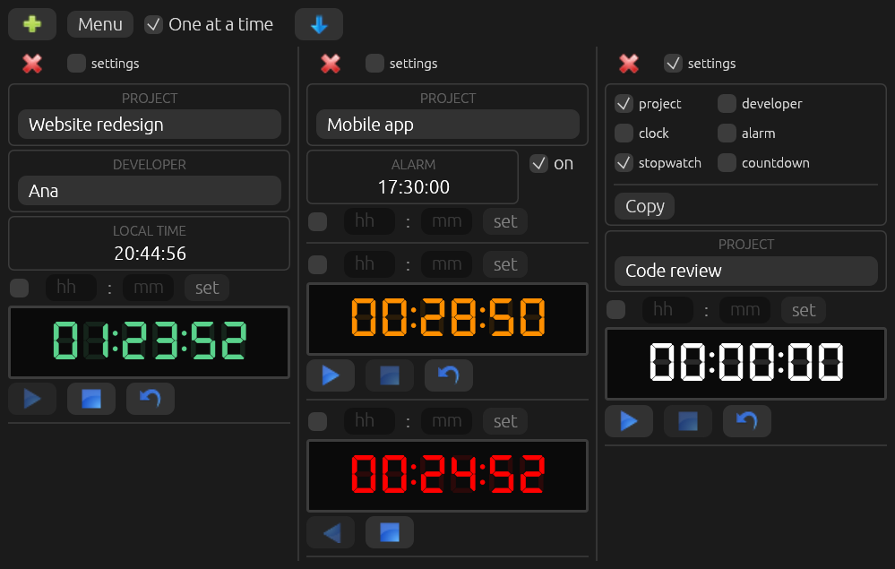

# CronoStack

Stopwatches side by side, for tracking time across projects. Each column can
also show a countdown, a daily alarm, the local time and project/developer
labels. **Copy** puts `developer, time, date, project` on the clipboard as a
spreadsheet row.

**▶ Try it now in your browser, nothing to install:
<https://danielemiliogarcia.github.io/cronostack-rs/>**


<p align="center">
  
  
</p>

Built in Rust with [egui/eframe](https://github.com/emilk/egui). Runs on
Linux, macOS and Windows, and in any current browser (WebAssembly).

## Features

- Any number of columns: add with **+**, remove with the red **X**.
- **One at a time:** starting a stopwatch pauses the others.
- Per-column **settings** to show or hide: project, developer, clock, alarm,
  stopwatch, countdown.
- The window resizes to fit its columns.
- **System tray:** hide the window, pause all, quit (desktop only).
- **Menu:**
  - **Theme:** *Classic* (light window, LCD-style displays) or *System*
    (follows your OS light/dark setting).
  - **Pause all.**
  - **Where is my data?** shows where your data is saved.
  - **About.**

## Use it

### Option 1: the web app (no install)

Open **<https://danielemiliogarcia.github.io/cronostack-rs/>**. It's the same
app compiled to WebAssembly and runs entirely in your browser: there's no
server and no account, and your columns stay in the browser's local storage
on your device.

Compared with the desktop app:

- No system tray, window hiding or auto-resizing.
- Data is kept per browser and device (clearing site data erases it).
- Sounds are synthesized by the browser (a pager-style beep for the alarm, a
  short chime when a countdown ends). Browsers allow sound only after you've
  clicked the page once.
- Background tabs are throttled, so an alarm or countdown in a hidden tab may
  ring late. Use the desktop app if you rely on the alarm.
- Needs WebGL, which all current browsers have.

### Option 2: install a verified binary release

Rust is not needed. The installer downloads the archive for your platform,
verifies its GitHub build-provenance attestation and SHA-256, and installs
`cronostack`:

- Linux and macOS: to `~/.local/bin`
- Windows: to `%LOCALAPPDATA%\cronostack\bin`

It uses the [GitHub CLI](https://cli.github.com/) (`gh`), logged in
(`gh auth login`), to download and verify releases.

Linux (x86-64, ARM64) and macOS (Apple silicon):

```bash
gh release download --repo danielemiliogarcia/cronostack-rs --pattern install.sh --clobber
gh attestation verify install.sh \
  --repo danielemiliogarcia/cronostack-rs \
  --signer-workflow danielemiliogarcia/cronostack-rs/.github/workflows/release.yml \
  --deny-self-hosted-runners
sh install.sh            # latest release; or a given one: sh install.sh 0.2.0
rm install.sh
```

Windows (x86-64), in PowerShell:

```powershell
gh release download --repo danielemiliogarcia/cronostack-rs --pattern install.ps1 --clobber
gh attestation verify install.ps1 `
  --repo danielemiliogarcia/cronostack-rs `
  --signer-workflow danielemiliogarcia/cronostack-rs/.github/workflows/release.yml `
  --deny-self-hosted-runners
./install.ps1            # latest release; or a given one: ./install.ps1 -Version 0.2.0
Remove-Item install.ps1
```

To install somewhere else, set `CRONOSTACK_INSTALL_DIR`.

### Option 3: download manually

No tools needed. Every
[release](https://github.com/danielemiliogarcia/cronostack-rs/releases/latest)
has an archive per platform plus `SHA256SUMS`:

| Platform | Archive |
|---|---|
| Linux x86-64 | `cronostack-<version>-x86_64-unknown-linux-gnu.tar.gz` |
| Linux ARM64 | `cronostack-<version>-aarch64-unknown-linux-gnu.tar.gz` |
| macOS Apple silicon | `cronostack-<version>-aarch64-apple-darwin.tar.gz` |
| Windows x86-64 | `cronostack-<version>-x86_64-pc-windows-msvc.zip` |

Unpack it and run `cronostack`. The binaries aren't code-signed yet:

- **macOS:** Gatekeeper blocks it the first time. Either run
  `xattr -d com.apple.quarantine cronostack`, or right-click it and choose
  **Open**.
- **Windows:** SmartScreen may warn. Choose **More info → Run anyway**.

Builds from the latest `main` are also available as artifacts of the
[CI workflow](https://github.com/danielemiliogarcia/cronostack-rs/actions/workflows/ci.yml).

**Linux requirements:** a desktop with X11 or Wayland and OpenGL. Any normal
desktop install has these. The tray icon needs a desktop that shows tray icons
(KDE, XFCE, or GNOME with the AppIndicator extension). Sounds are played with
`paplay`, `pw-play`, `aplay` or `ffplay`, whichever is installed.

### Option 4: build from source

```bash
# Uses the Rust toolchain pinned in rust-toolchain.toml (1.100.0);
# rustup installs it automatically.
git clone https://github.com/danielemiliogarcia/cronostack-rs.git
cd cronostack-rs
cargo install --locked --path .
```

To build and run the web version yourself:

```bash
rustup target add wasm32-unknown-unknown
cargo install --locked trunk
trunk serve --open          # development server with live reload
trunk build --release       # static site in dist/, ready to host anywhere
```

`dist/` is a plain static site (HTML, JavaScript and a `.wasm` file), so any
static host works: GitHub Pages, Netlify, Cloudflare Pages… If it's served
from a subfolder, build with `--public-url /subfolder/`.

## Data

The desktop app saves its state as TOML on exit and every 30 seconds, in the
OS data folder:

| OS      | path |
|---------|------|
| Linux   | `~/.local/share/cronostack/state.toml` |
| macOS   | `~/Library/Application Support/cronostack/state.toml` |
| Windows | `%APPDATA%\cronostack\data\state.toml` |

Set `CRONOSTACK_DATA_DIR` to use another folder (e.g. for a portable install).
Stopwatches are paused when the app quits. If the file can't be read, it's
renamed to `state.toml.broken` and the app starts empty.

The web app saves the same TOML in the browser's local storage every 5
seconds.

## Command line

```text
cronostack                 start the app
cronostack --version       print the version
cronostack --help          print help
cronostack --smoke-test    open the window, render, check saving, exit 0 on success
```

Set `RUST_LOG=cronostack=info` to see logs.

On Windows `cronostack.exe` is a GUI app, so PowerShell only shows its output
when piped: `cronostack --version | Out-String`.

## Cargo features

| feature        | default | what it does |
|----------------|---------|--------------|
| `tray`         | yes     | System tray icon. On Linux it uses the pure-Rust KSNI backend, so GTK isn't needed. |
| `native-audio` | no      | Plays sounds in-process with `rodio`. On Linux this needs ALSA headers (`libasound2-dev`) to build. |

Icons, font and sounds are embedded in the binary.

## Development

```bash
cargo test
cargo clippy --all-targets -- -D warnings
cargo clippy --target wasm32-unknown-unknown -- -D warnings
cargo fmt --all
```

**Supply chain.** `.cargo/config.toml` only allows crate versions that have
been on crates.io for at least 14 days, and CI builds with `--locked` from the
committed `Cargo.lock`.

**CI.** Every pull request and push to `main` runs formatting, lints and
tests. It builds the four desktop targets, runs `--smoke-test` on each (with a
virtual display and software OpenGL on Linux and Windows), builds the web
version, and uploads everything as artifacts.

**Web app.** Every push to `main` rebuilds the web version and publishes it
to GitHub Pages ([`pages.yml`](.github/workflows/pages.yml)).

**Releases.** See [RELEASING.md](RELEASING.md). They're published only from a
YubiKey-signed version tag.

| module          | what it does |
|-----------------|--------------|
| `main.rs`       | picks the desktop or web entry point |
| `desktop.rs`    | desktop: command line, native window |
| `web.rs`        | web: runs the app in the page's canvas |
| `app.rs`        | main window: top bar, menu, dialogs, tray commands, saving, auto-resize |
| `column/`       | one column: `stopwatch.rs`, `countdown.rs`, `alarm.rs` (logic, unit tested) and `ui.rs` (drawing) |
| `persistence.rs`| `AppState` ↔ TOML (file on the desktop, local storage on the web) |
| `theme.rs`      | `ThemeMode` (Classic/System) and the `Palette` used by widgets |
| `clock.rs`      | time helpers |
| `sound.rs`      | alarm and countdown sounds (sound files on the desktop, synthesized on the web) |
| `tray.rs`       | tray icon and menu |
| `widgets.rs`    | shared widgets, embedded icons and font |

Contributions are welcome: open an issue or a pull request.

## Credits

- Display font: [DSEG7 Classic](https://github.com/keshikan/DSEG) by
  keshikan, under the SIL Open Font License 1.1
  ([`assets/fonts/DSEG-LICENSE.txt`](assets/fonts/DSEG-LICENSE.txt)).

## License

CronoStack is licensed under the [Apache License 2.0](LICENSE). The bundled
font keeps its own license (see Credits).
