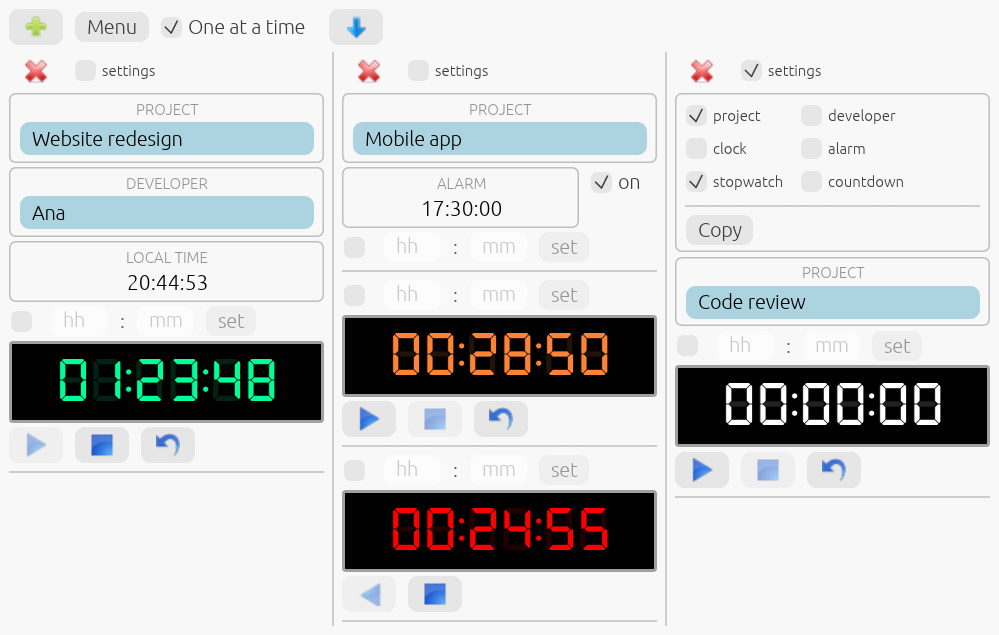
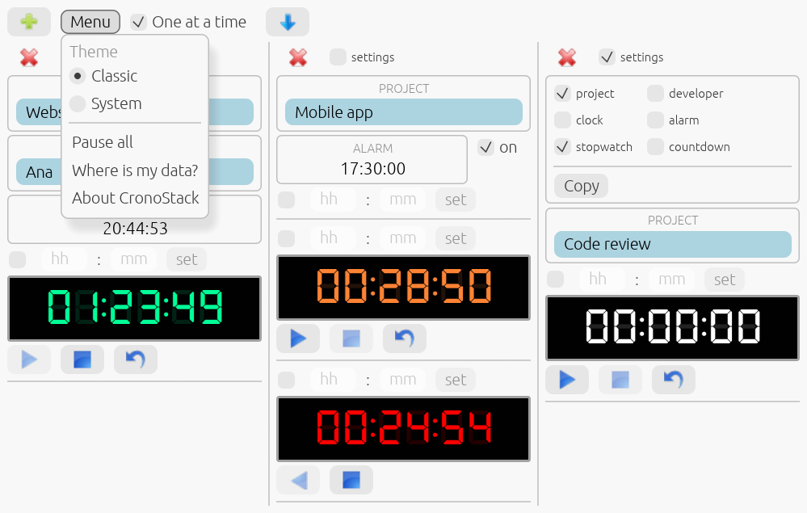

# CronoStack

Stopwatches side by side, for tracking time across projects. Each column can
also show a countdown, a daily alarm, the local time and project/developer
labels. **Copy** puts `developer, time, date, project` on the clipboard as a
spreadsheet row.



<p align="center">
  
  
</p>

Built in Rust with [egui/eframe](https://github.com/emilk/egui). Runs on
Linux, macOS and Windows.

## Install

### Option 1: install a binary release

Rust is not needed. The installer downloads the archive for your platform,
checks its SHA-256 and installs `cronostack`:

- Linux and macOS: to `~/.local/bin`
- Windows: to `%LOCALAPPDATA%\cronostack\bin`

The repository is private for now, so the
[GitHub CLI](https://cli.github.com/) (`gh`), logged in with access to it, is
needed to download releases.

Linux (x86-64, ARM64) and macOS (Apple silicon):

```bash
gh release download --repo danielemiliogarcia/cronostack-rs --pattern install.sh --clobber
sh install.sh            # latest release; or: sh install.sh 0.1.0
rm install.sh
```

Windows (x86-64), in PowerShell:

```powershell
gh release download --repo danielemiliogarcia/cronostack-rs --pattern install.ps1 --clobber
./install.ps1            # latest release; or: ./install.ps1 -Version 0.1.0
Remove-Item install.ps1
```

To install somewhere else, set `CRONOSTACK_INSTALL_DIR`. Once the repository
is public, the installers also verify each archive's GitHub build-provenance
attestation.

**Manual download:** every
[release](https://github.com/danielemiliogarcia/cronostack-rs/releases) has
an archive per platform plus `SHA256SUMS`:

| Platform | Archive |
|---|---|
| Linux x86-64 | `cronostack-<version>-x86_64-unknown-linux-gnu.tar.gz` |
| Linux ARM64 | `cronostack-<version>-aarch64-unknown-linux-gnu.tar.gz` |
| macOS Apple silicon | `cronostack-<version>-aarch64-apple-darwin.tar.gz` |
| Windows x86-64 | `cronostack-<version>-x86_64-pc-windows-msvc.zip` |

Unpack it and run `cronostack`. The binaries aren't code-signed yet:

- **macOS:** Gatekeeper blocks it the first time. Either run
  `xattr -d com.apple.quarantine cronostack`, or right-click it and choose
  **Open**.
- **Windows:** SmartScreen may warn. Choose **More info → Run anyway**.

Builds from the latest `main` are also available as artifacts of the
[CI workflow](https://github.com/danielemiliogarcia/cronostack-rs/actions/workflows/ci.yml).

**Linux requirements:** a desktop with X11 or Wayland and OpenGL. Any normal
desktop install has these. The tray icon needs a desktop that shows tray icons
(KDE, XFCE, or GNOME with the AppIndicator extension). Sounds are played with
`paplay`, `pw-play`, `aplay` or `ffplay`, whichever is installed.

### Option 2: build from source

```bash
# Uses the Rust toolchain pinned in rust-toolchain.toml (1.100.0);
# rustup installs it automatically.
git clone https://github.com/danielemiliogarcia/cronostack-rs.git
cd cronostack-rs
cargo install --locked --path .
```

## Features

- Any number of columns: add with **+**, remove with the red **X**.
- **One at a time:** starting a stopwatch pauses the others.
- Per-column **settings** to show or hide: project, developer, clock, alarm,
  stopwatch, countdown.
- The window resizes to fit its columns.
- **System tray:** hide the window, pause all, quit.
- **Menu:**
  - **Theme:** *Classic* (light window, LCD-style displays) or *System*
    (follows your OS light/dark setting).
  - **Pause all.**
  - **Where is my data?** shows the file path, with *Copy path* and
    *Open folder*.
  - **About.**

## Data

State is saved as TOML on exit and every 30 seconds, in the OS data folder:

| OS      | path |
|---------|------|
| Linux   | `~/.local/share/cronostack/state.toml` |
| macOS   | `~/Library/Application Support/cronostack/state.toml` |
| Windows | `%APPDATA%\cronostack\data\state.toml` |

Set `CRONOSTACK_DATA_DIR` to use another folder (e.g. for a portable install).
Stopwatches are paused when the app quits. If the file can't be read, it's
renamed to `state.toml.broken` and the app starts empty.

## Command line

```text
cronostack                 start the app
cronostack --version       print the version
cronostack --help          print help
cronostack --smoke-test    open the window, render, check saving, exit 0 on success
```

Set `RUST_LOG=cronostack=info` to see logs.

On Windows `cronostack.exe` is a GUI app, so PowerShell only shows its output
when piped: `cronostack --version | Out-String`.

## Cargo features

| feature        | default | what it does |
|----------------|---------|--------------|
| `tray`         | yes     | System tray icon. On Linux it uses the pure-Rust KSNI backend, so GTK isn't needed. |
| `native-audio` | no      | Plays sounds in-process with `rodio`. On Linux this needs ALSA headers (`libasound2-dev`) to build. |

Icons, font and sounds are embedded in the binary.

## Development

```bash
cargo test
cargo clippy --all-targets -- -D warnings
cargo fmt --all
```

**Supply chain.** `.cargo/config.toml` only allows crate versions that have
been on crates.io for at least 14 days, and CI builds with `--locked` from the
committed `Cargo.lock`.

**CI.** Every pull request and push to `main` runs formatting, lints and
tests. It also builds the four release targets, runs `--smoke-test` on each
(with a virtual display and software OpenGL on Linux and Windows), and uploads
the binaries as artifacts.

**Releases.** See [RELEASING.md](RELEASING.md). They're published only from a
YubiKey-signed version tag.

| module          | what it does |
|-----------------|--------------|
| `main.rs`       | command line, starts the app |
| `app.rs`        | main window: top bar, menu, dialogs, tray commands, saving, auto-resize |
| `column/`       | one column: `stopwatch.rs`, `countdown.rs`, `alarm.rs` (logic, unit tested) and `ui.rs` (drawing) |
| `persistence.rs`| `AppState` ↔ TOML file |
| `theme.rs`      | `ThemeMode` (Classic/System) and the `Palette` used by widgets |
| `clock.rs`      | time helpers |
| `sound.rs`      | alarm and countdown-end sounds |
| `tray.rs`       | tray icon and menu |
| `widgets.rs`    | shared widgets, embedded icons and font |
